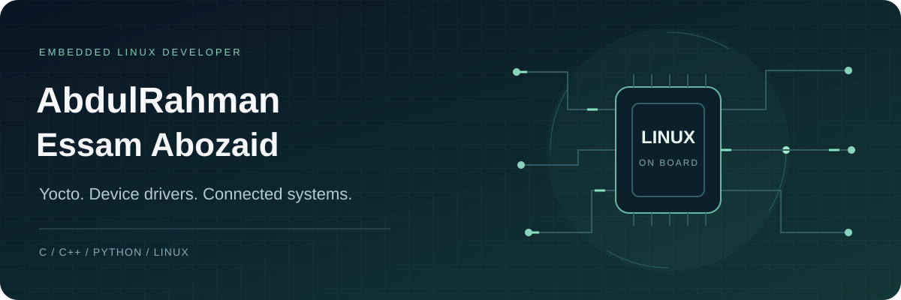
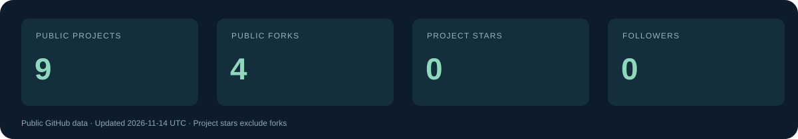

  

  <a href="https://github.com/AbdulRahmanEssamAbozaid?tab=repositories">Projects</a> ·
  <a href="https://www.linkedin.com/in/abdo-essam-abozaid-441ab4244">LinkedIn</a> ·
  <a href="mailto:abdoessamabozaid@gmail.com">Email</a>

## About me

I'm **AbdulRahman Essam Abozaid**, an Embedded Linux developer based in Cairo. I work with C, C++, Python and shell scripting across embedded software, Linux systems and connected devices.

My projects and learning focus on Yocto-based Linux images, Raspberry Pi, QEMU, device drivers, AUTOSAR and embedded networking. I enjoy working through the path from a board and its operating system to the applications running on it.

## Selected projects

| Project | What you'll find | Stack |
| --- | --- | --- |
| [IoT Communication System](https://github.com/AbdulRahmanEssamAbozaid/IOT_Communication_System) | TCP client/server and UDP multicast communication for Raspberry Pi 4 and QEMU. | C++ · Sockets · Yocto |
| [AUTOSAR](https://github.com/AbdulRahmanEssamAbozaid/AUTOSAR) | AUTOSAR architecture coursework and a Port Driver implementation. | C · MCAL · Device drivers |
| [vSomeIP](https://github.com/AbdulRahmanEssamAbozaid/VSOME-IP) | Setup notes and examples for host and Raspberry Pi environments. | C++ · SOME/IP · Yocto |
| [Qt applications](https://github.com/AbdulRahmanEssamAbozaid/QT-app) | Application examples built with Qt 6. | C++ · Qt |

## Tools I work with

| Area | Technologies |
| --- | --- |
| Languages | C, C++, Python, Bash |
| Embedded Linux | Yocto, BitBake, U-Boot, BusyBox, systemd, QEMU |
| Hardware | Raspberry Pi, ARM Cortex-M, TM4C / Tiva C, AVR |
| Embedded software | AUTOSAR, RTOS, bare-metal development, device drivers |
| Networking | TCP/IP, UDP, IPC, CommonAPI / vSomeIP |
| Application development | Qt, QML, CMake, Git |

## Currently exploring

- Linux kernel modules and device driver development.
- Yocto layers, image customization and build automation.
- Embedded networking with CommonAPI and vSomeIP.
- AUTOSAR MCAL modules for ARM microcontrollers.

## Education

**Bachelor of Space Navigation Engineering — Bani Suef University**

Class of 2025 · GPA 3.4

**Graduation project — Mixed Reality and AI-Based Airport Navigation System**

A virtual airport navigation simulation integrating AI-based guidance and embedded communication.

## GitHub activity

  

These figures are refreshed weekly from GitHub's public API. You can see the snapshot date in the image and the underlying values in [profile-stats.json](assets/profile-stats.json).

How this profile stays up to date

The profile banner and statistics are stored in this repository. The refresh workflow runs weekly and can also be started manually from [Actions](https://github.com/AbdulRahmanEssamAbozaid/AbdulRahmanEssamAbozaid/actions). The graphics use SVG and remain readable when animation is disabled.

---

If you'd like to discuss embedded Linux, device drivers or connected systems, reach me on [LinkedIn](https://www.linkedin.com/in/abdo-essam-abozaid-441ab4244) or by [email](mailto:abdoessamabozaid@gmail.com).
